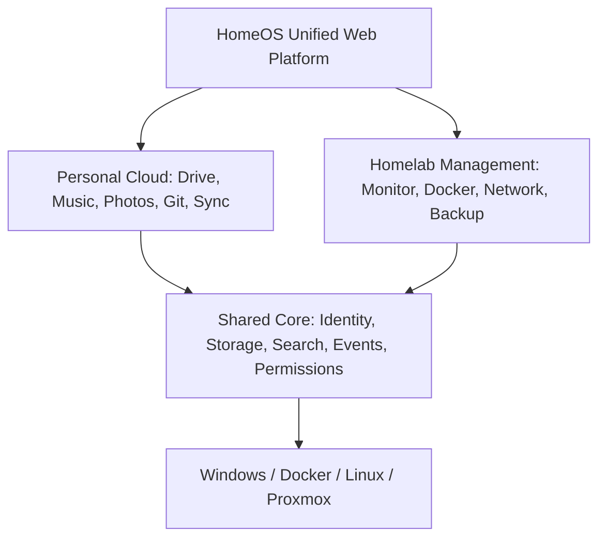
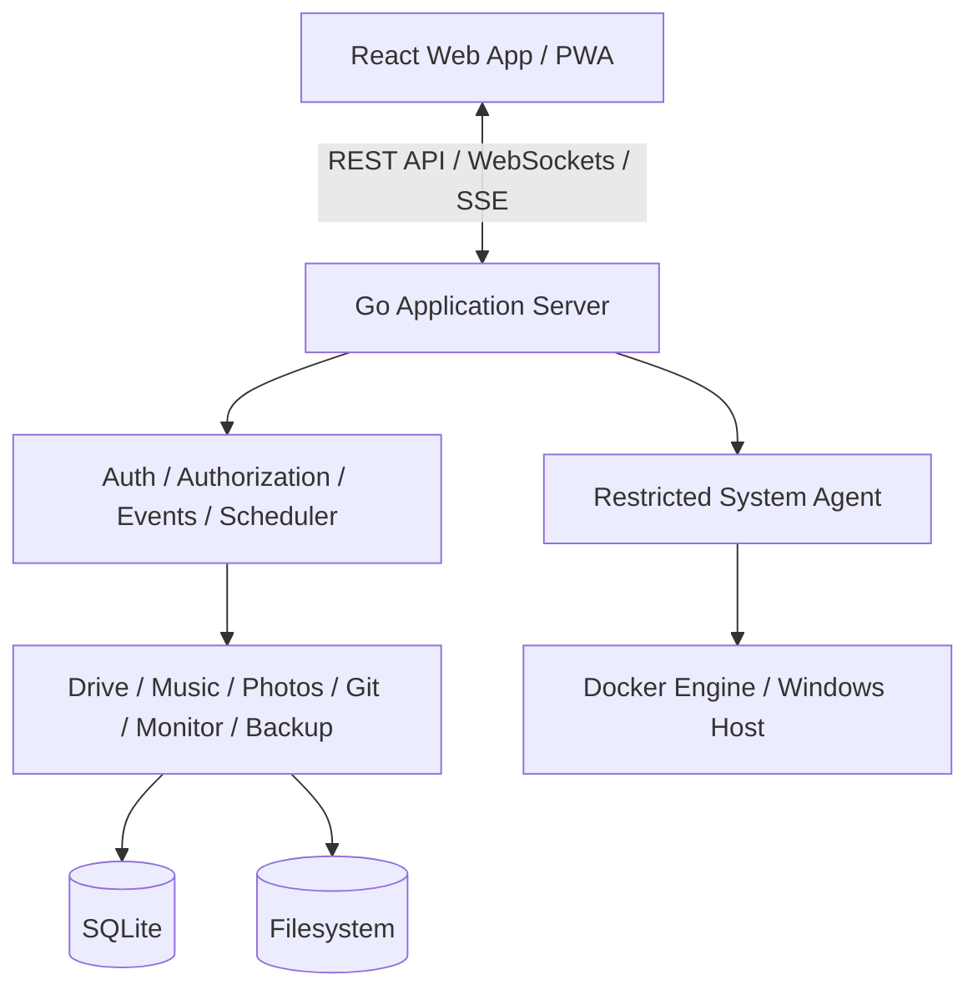

# HomeOS — Project Concept and Technical Design Report

**Project:** Personal Cloud & Homelab Management Platform  
**Document type:** Software Project Proposal & Preliminary System Design  
**Version:** 1.0 — Concept and Planning  
**Date:** October 10, 2026  
**Status:** Proposed — Development not yet started

---

## 1. Executive Summary

**HomeOS** is a proposed self-hosted software platform designed to combine personal cloud services and homelab infrastructure management into one integrated application.

The project aims to replace the fragmented experience of running multiple independent services—such as Nextcloud, Navidrome, Forgejo, Syncthing, AdGuard Home, and Uptime Kuma—with a unified platform featuring consistent navigation, authentication, storage management, monitoring, and automation.

HomeOS will be developed primarily from scratch using **Go for the backend, ReactJS with TypeScript for the frontend, and SQLite for data management**. Established open-source libraries and system utilities will be used where appropriate to maintain reliability and avoid unnecessary reimplementation.

The initial deployment target is a Windows-based Docker homelab powered by an Intel Core i7-11800H processor and 16 GB of RAM. The architecture will remain portable to Linux and Proxmox environments.

### Primary objectives

- Consolidate personal cloud services and server administration.
- Minimize CPU, memory, and background resource consumption.
- Develop modular, independently controlled software components.
- Enable secure access from computers, smartphones, and tablets.
- Provide unified storage, search, authentication, and automation.
- Support future AI-assisted system management.
- Gradually reduce dependence on multiple standalone applications.

## 2. Problem Statement

### 2.1 Current environment

| Existing application | Current responsibility |
|---|---|
| Nextcloud | Cloud file storage |
| Navidrome | Music streaming |
| Forgejo | Git repository hosting |
| Syncthing | Device synchronization |
| AdGuard Home | DNS-based content filtering |
| Uptime Kuma | Service availability monitoring |
| Tailscale | Secure remote network access |
| Docker Desktop | Container execution and management |

### 2.2 Identified limitations

- **Fragmented user experience:** Switching between multiple browser tabs and interfaces.
- **Independent data management:** Separate metadata, permissions, and file structures.
- **Operational complexity:** Independent deployment, monitoring, backups, and configuration.
- **Limited cross-service automation:** Workflows spanning services need additional scripts or integrations.
- **Resource overhead:** Multiple background processes and runtime dependencies.

### 2.3 Proposed solution

HomeOS provides a common application framework with shared infrastructure services and independently enabled functional modules, supporting both personal-cloud activities and homelab administration.

## 3. System Vision and Scope

HomeOS is a **web-based personal cloud and homelab management platform**, not a replacement for the Windows or Linux kernel.



### Design principles

1. **Lightweight by default:** Minimize idle resource consumption and unnecessary dependencies.
2. **Modular:** Enable or disable features independently, with separable updates where feasible.
3. **Unified:** Share common core services.
4. **Secure:** Centralize authentication, permissions, and administrative controls.
5. **Portable:** Avoid unnecessary dependence on a single host operating system.
6. **Extensible:** Offer stable interfaces for future modules and automation.

## 4. Proposed Technology Stack

| Layer | Technology | Justification |
|---|---|---|
| Frontend | ReactJS | Component-based, responsive interface |
| Frontend language | TypeScript | Type safety and maintainability |
| Build system | Vite | Fast development and static builds |
| Styling | Tailwind CSS | Consistent styling |
| UI components | shadcn/ui | Customizable component foundation |
| Backend | Go | Efficient concurrency and native compilation |
| HTTP routing | Chi | Lightweight routing |
| Database | SQLite | Embedded database and low deployment overhead |
| Real-time updates | WebSockets / SSE | Monitoring and notifications |
| Media processing | FFmpeg | Audio/video metadata and transcoding |
| Git operations | Git CLI or Go libraries | Repository management |
| AI processing | Python (optional) | ML and automation |
| Deployment | Docker Compose | Reproducible deployment |
| Remote access | Tailscale initially | Private, authenticated access |

### 4.1 Backend language selection

Go is recommended over C and C++ for the primary backend because most HomeOS workloads involve network I/O, HTTP requests, file operations, background jobs, and concurrent connections. C++ may be introduced for specialized native components if profiling demonstrates a measurable benefit.

### 4.2 Frontend deployment

React is compiled into static assets that the Go server can embed and serve. A separate Node.js runtime is unnecessary in production.

### 4.3 Database strategy

SQLite stores users, permissions, file metadata, playlists, settings, events, and jobs. Actual files, media, and repositories remain on filesystem storage. PostgreSQL is a possible future option if concurrency or operational requirements demand it.

## 5. Functional Module Specifications

### 5.1 Personal Cloud Modules

#### HomeDrive — File Storage

File/folder management, uploads, downloads, previews, sharing, recycle bin, version history, and storage quotas. **Target replacement:** Nextcloud.

#### HomeMusic — Media Streaming

Music scanning, playback, playlists, metadata, album artwork, search, and optional audio analysis. **Target replacement:** Navidrome.

#### HomePhotos — Photo Management

Image galleries, albums, thumbnails, metadata indexing, automatic organization, and optional AI classification.

#### HomeGit — Development Services

Repository creation, Git hosting, source browsing, commits, branches, and eventually issues/project management. **Target replacement:** Forgejo.

#### HomeSync — Device Synchronization

Cross-device synchronization, change detection, conflict handling, and synchronization policies. **Target replacement:** Syncthing.

### 5.2 Infrastructure Management Modules

| Module | Primary capabilities |
|---|---|
| HomeMonitor | CPU, RAM, disk, network metrics, health checks, logs |
| HomeDocker | Container status, start/stop/restart, resource usage |
| HomeNetwork | DNS configuration, network information, remote-access management |
| HomeBackup | Backup schedules, integrity checks, restore operations |
| HomeCam | Camera streaming, recording, motion detection |
| HomeTasks | Script execution, scheduled tasks, automation workflows |

Administrative operations require authorization. The application must not expose unrestricted Docker control or host-level command execution to ordinary users.

### 5.3 Intelligence and Automation

Optional **HomeAI** capabilities:

- Natural-language search across modules.
- File, image, and music classification.
- System-health analysis and troubleshooting suggestions.
- Automation and workflow assistance.
- Recommendations based on monitored metrics.

AI workers run separately and can be disabled without disrupting core services.

## 6. System Architecture

A **modular monolith** is recommended initially: one Go application with clearly separated internal modules, rather than a separate microservice per feature.



### 6.1 Module communication

- **Direct service interfaces:** Synchronous operations such as file metadata requests and permission checks.
- **Internal event bus:** Asynchronous tasks such as file indexing, backups, and notifications.

Example:

```text
User uploads music file
  -> HomeDrive stores file
  -> HomeOS publishes FileCreated event
  -> HomeMusic indexes metadata
  -> HomeSearch updates its index
  -> HomeOS sends notification
```

Persistent jobs, retries, and restart recovery should be supported for important asynchronous work.

### 6.2 Unified storage

Modules use a shared logical storage layer. A file can appear in multiple modules without requiring multiple physical copies, subject to permissions and lifecycle rules.

### 6.3 Host system management

Because deployment begins on Windows with Docker Desktop, Windows-specific metrics and actions may require a restricted host agent. Docker management should use a narrowly controlled interface instead of unrestricted Docker Engine access.

## 7. Preliminary Project Structure

```text
homeos/
├── frontend/
│   ├── src/
│   │   ├── app/
│   │   ├── components/
│   │   ├── layouts/
│   │   ├── pages/
│   │   ├── modules/
│   │   ├── hooks/
│   │   ├── services/
│   │   └── styles/
│   ├── package.json
│   └── vite.config.ts
├── backend/
│   ├── cmd/homeos/
│   ├── internal/
│   │   ├── core/
│   │   │   ├── auth/
│   │   │   ├── config/
│   │   │   ├── database/
│   │   │   ├── events/
│   │   │   ├── storage/
│   │   │   └── permissions/
│   │   ├── modules/
│   │   │   ├── drive/
│   │   │   ├── music/
│   │   │   ├── photos/
│   │   │   ├── git/
│   │   │   ├── monitor/
│   │   │   ├── docker/
│   │   │   └── backup/
│   │   └── api/
│   ├── migrations/
│   └── go.mod
├── agents/windows/
├── workers/ai/
├── data/
│   ├── files/
│   ├── media/
│   ├── repositories/
│   └── backups/
├── deploy/docker/
├── docs/
├── tests/
└── docker-compose.yml
```

This structure is preliminary and may evolve during implementation.

## 8. User Interface and Experience

HomeOS uses a responsive dashboard-oriented interface with consistent navigation between personal-cloud and infrastructure features.

| Interface | Purpose |
|---|---|
| Dashboard | Overall system status and recent activity |
| Cloud | Files, photos, music, and media |
| Development | Git repositories and project tools |
| Infrastructure | Containers, host metrics, network |
| Automation | Scheduled jobs and workflows |
| Administration | Users, permissions, configuration |

The dashboard should support customizable widgets. PWA capabilities may allow installation on desktop and mobile devices using one codebase.

## 9. Non-Functional Requirements

### 9.1 Performance

Initial engineering targets (not benchmarks or guarantees):

| Metric | Proposed target |
|---|---|
| Core backend idle memory | Under 100 MB, subject to testing |
| Core backend idle CPU | Approximately 0–2% on the target host |
| Core API response | Under 100 ms for simple local requests |
| Initial dashboard load | Under 2 seconds on a typical LAN |
| Deployment | One main application container plus optional agents |
| Concurrent users | Initially optimized for 1–5 users |

These figures require validation through profiling and realistic workload tests.

### 9.2 Security

- Secure authentication and session management.
- Role-based access control.
- HTTPS for remote access.
- Protection against unauthorized filesystem access.
- Restricted administrative actions.
- Audit logging for sensitive operations.
- Secure secret storage and configuration.
- Explicit confirmation for destructive operations.

Initially, access should be restricted to the LAN or an authenticated private-access solution such as Tailscale.

### 9.3 Reliability

Core functionality must remain usable if optional modules fail. Long-running tasks need cancellation, retries, and restart recovery. Backups and restore testing should be implemented before HomeOS becomes the primary data platform.

## 10. Migration Strategy

1. **Integration:** Connect to existing services through supported APIs and read-only access where appropriate; preserve originals.
2. **Native implementation:** Build and independently test HomeOS modules against existing service functionality.
3. **Controlled migration:** Transfer data using supported export/import processes; verify integrity and retain rollback options.
4. **Consolidation:** Retire redundant services only when replacement functionality, security, and reliability are adequate.

Specialized VPN, DNS, and synchronization components may remain separate if reimplementing them would create unnecessary security or reliability risks.

## 11. Development Roadmap

| Release | Planned scope | Completion criteria |
|---|---|---|
| v0.1 | HomeCore, authentication, dashboard, basic monitoring | Sign in and view server status |
| v0.2 | HomeDrive | Secure file upload, download, folders |
| v0.3 | HomeMusic | Scan and stream an existing music library |
| v0.4 | HomeDocker, notifications, scheduled tasks | Safely monitor and manage authorized containers |
| v0.5 | HomeBackup, HomePhotos | Backup/restore and image gallery |
| v0.6 | HomeGit | Repository hosting and browsing |
| v0.7 | HomeSync | Tested synchronization and conflict handling |
| v0.8 | HomeNetwork, HomeCam | Network administration and camera functionality |
| v0.9 | HomeAI, workflow automation | AI-assisted search and automation |
| v1.0 | Security hardening, testing, documentation | Stable daily-use release |

These are development phases, not committed delivery dates.

## 12. Major Technical Risks

| Risk | Impact | Mitigation |
|---|---|---|
| Data loss during migration | Critical | Verified backups and rollback procedures |
| Security flaws in custom cloud software | Critical | Security reviews, proven libraries, automated tests |
| Excessive project scope | High | Modular releases and clear MVP |
| Windows/Docker limitations | Medium | Host agent and cross-platform abstraction |
| Synchronization conflicts | High | Version tracking and deterministic conflict policies |
| Database corruption | High | Transactions, backups, integrity checks |
| Privileged Docker access | Critical | Isolated, restricted management agent |
| Resource usage growth | Medium | Profiling, lazy loading, optional modules |

The greatest challenge is maintaining data integrity, security, and reliability across interconnected services—not simply selecting a programming language.

## 13. Long-Term Vision

After a stable 1.0 release, HomeOS could evolve into a broader self-hosted application platform with a module SDK, plugin marketplace, multi-server management, native clients, intelligent storage management, and distributed workloads across homelab machines.

The system could eventually manage personal applications and infrastructure across Windows, Linux, and virtualized environments.

## 14. Conclusion and Recommendation

HomeOS is technically feasible as a long-term engineering project if developed incrementally.

The recommended foundation is a **Go modular-monolith backend, ReactJS/TypeScript frontend, SQLite database, shared filesystem storage, and Docker deployment**.

The first milestone should focus on **HomeCore, HomeMonitor, and HomeDrive**. HomeMusic should follow after authentication, storage, and permissions are reliable.

This approach delivers a useful application early while building the foundation for synchronization, Git hosting, backups, AI, and infrastructure management.

**Recommended next deliverable:** A Software Requirements Specification (SRS) covering functional requirements, API contracts, database schema, module boundaries, permissions, and v0.1 acceptance criteria.
